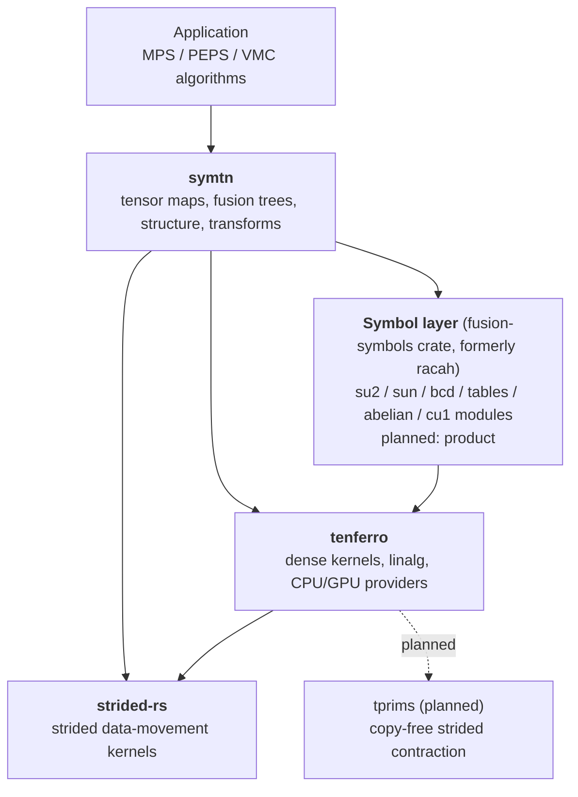
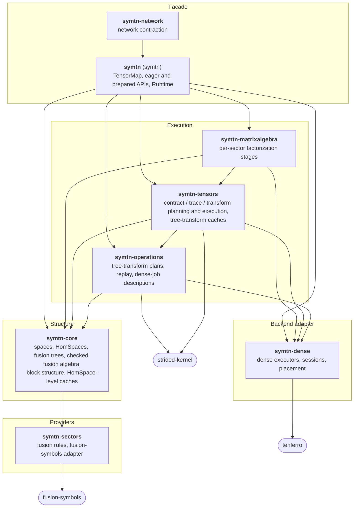

# Layering and ownership

symtn is one layer of a stack. Each layer owns one kind of knowledge and
reaches the next layer through a narrow interface. This document is the
authority for **which layer owns what**. Each section separates the
**target** ownership from the **current** state; the
[deviations](#current-deviations-tracked) list what still differs.

The split follows TensorKit's ecosystem:

| Concern | TensorKit ecosystem | This stack |
| --- | --- | --- |
| Elementary categorical data | WignerSymbols.jl, SUNRepresentations.jl, TensorKitSectors.jl, CategoryData.jl | the [`fusion-symbols`](https://github.com/Ryo-wtnb11/fusion-symbols) crate (formerly `racah`), 0.4.0 |
| Symmetric tensors, fusion trees, structure, transforms | TensorKit.jl | symtn |
| Dense arrays, linear algebra, devices | LinearAlgebra, TensorOperations.jl | tenferro |
| Strided data movement | Strided.jl | strided-rs (`strided-kernel`) |
| Copy-free strided contraction | TBLIS via TensorOperations | tprims, inside tenferro (planned) |
| Multi-device and distributed execution | — | hataori (planned) |

## Layers



The arrows show dependency direction, and no layer depends upward.

The symbol layer uses tenferro only for the dense linear algebra of CGC
generation (`fusion-symbols` `src/sun/linalg.rs` and `src/bcd/linalg.rs`, behind
`cgc-gen`). It uses no tensor or fusion-tree concept.

### 1. Symbol layer (`fusion-symbols` crate)

The symbol layer is the published `fusion-symbols` crate (formerly `racah`),
which symtn depends on at 0.4.0.

**Target ownership.** For each group or category, the symbol layer owns the
elementary data a fusion category needs:
- the fusion rule and multiplicities `N^{ab}_c`;
- dimensions and the dual;
- the Frobenius–Schur phase and indicator;
- the twist;
- 3j and 6j symbols, CGC, F-symbols and R-symbols;
- the caches of that data.

It owns nothing about tensors, fusion trees as symtn represents them, block
structures, layouts or sector-label encodings (`SectorId`), and nothing
shaped around one consumer's call pattern.

| Crate | Owns |
| --- | --- |
| `fusion-symbols` (formerly `racah`), modules `su2`, `sun`, `bcd` | Lie-group coefficients. SU(2) symbols are exact. Behind `cgc-gen` it generates CGC, F and R: SU(N) in the SUNRepresentations gauge, and B/C/D (SO(N)/Sp(2N)) in fusion-symbols' QSpace-derived sweep gauge (`docs/gauge_soN.md`). |
| `fusion-symbols`, module `tables` | The pinned AnyonWiki tables (unitary, rank ≤ 4) behind `TableRule`, Fibonacci included (#2016, #2277). |
| `fusion-symbols`, modules `abelian`, `cu1` | Z2, Z_N, U(1), fermion parity and CU(1): every symbol behind `Z2FusionRule`, `ZNFusionRule`, `U1FusionRule`, `FermionParityFusionRule` and `CU1FusionRule` (#2278). symtn keeps their labels, codecs, identities and checked errors. |
| `fusion-symbols`, planned module `product` | Deligne products; they stay in symtn (`ProductFusionRule`) until that module ships. |

**Target: one provider shape across crates.** Every crate should answer N,
dims, dual, FS phase and indicator, twist, F and R in the same shape, so a
consumer adapts every crate the same way.

**Current: the surface is not uniform.**
- SU(2) uses free functions (`su2_frobenius_schur`, `su2_twist`).
- SU(N) uses `Irrep` methods (`frobenius_schur_phase`, `frobenius_schur`, `twist`).
- B/C/D has the FS indicator and twist but no FS-phase API.

**Contracts.**
- **References.** Each function documents the reference `file:symbol` it
  reproduces. SU(N) follows SUNRepresentations.jl and TensorKitSectors.jl.
  B/C/D follows QSpace, because the Julia packages do not cover SO(N) or
  Sp(2N).
- **Twists.** The twist of a group irrep is exactly 1, because group braiding
  is bosonic.
- **Frobenius–Schur.** The FS *phase* is ±1 for every irrep. The FS
  *indicator* is 0 for irreps that are not self-dual. In the SUNRepresentations
  gauge the phase is −1 on some complex irreps, e.g. the SU(4) fundamental.
- **Caching.** Every tier is process-global and in-memory: SU(2) 3j, 6j and
  derived F, and under `cgc-gen` the SU(N) product, CGC and F tiers and the
  B/C/D CGC and F tiers. Today each tier evicts FIFO under its own fixed byte
  cap, set as a static partition. Moving these tiers onto a shared weighted
  cache is fusion-symbols#117.
- **R is uncached by design.** Each R is one sparse join of cached CGC.
- **On-disk persistence** of expensive coefficients is a proposal (fusion-symbols#106).
  Current fusion-symbols documents an in-memory-only cache.
- **Cache control.** Only the **application** may reset, trim or re-budget
  these caches; a library never does (`src/cache.rs`).
- **Reproducibility.** A documented gauge fixes the coefficients. Their
  floating-point bits may differ across dense backends or thread counts,
  within tolerance.

### 2. symtn (this repository)

**Owns:**
- tensor maps and graded spaces;
- fusion trees and their transformations (permute, braid, transpose, bend,
  fold, repartition);
- the composition of elementary symbols into fusion-tree transformation
  coefficients, including the A/B symbols derived from F, FS and dims;
- sector and degeneracy structure, and reduced-block layout;
- contraction route planning;
- structural pack, scatter and permutation decisions;
- the caches of all of the above.

**Does not own:**
- generation or caching of elementary symbols; symtn only adapts them;
- dense kernels, factorization algorithms, provider or device dispatch,
  provider workspace, or the choice of dense kernel. These belong to
  tenferro, or to strided-rs for data movement.
- application schedules: MPS, PEPS, VMC or device-transfer plans.

| Crate | Owns |
| --- | --- |
| `symtn-sectors` | Fusion-rule providers and the adapter onto the symbol layer. **Rule (target):** codec and type conversion only, with no symbol math and no symbol-layer types or cache policy in its public API. Current gap: #2016. |
| `symtn-core` | Spaces, HomSpaces, fusion trees, checked fusion algebra, block structure, and the HomSpace-level structure caches. |
| `symtn-operations` | Tree-transform plans, replay, and stacked/direct dense-job descriptions, with strided data movement. |
| `symtn-tensors` | Contraction, trace and transform planning and execution over reduced blocks, and the tree-transform caches. |
| `symtn-matrixalgebra` | Per-sector factorization stages over a mode-generic factor-space authority. |
| `symtn-dense` | The only adapter onto tenferro: dense executors, sessions and device placement. |
| `symtn` (`symtn`) | Typed facade: `TensorMap`, the eager and prepared APIs, and `Runtime`. |
| `symtn-network` | Labeled network contraction (`Network::contract`), planning and the plan cache. |
| `symtn-macros` | The `contract!` index-notation proc macro, re-exported by `symtn-network`; syntax and compile-time label validation only. |

**Structure-layer caches.** Four caches, mirroring TensorKit's
`@cached` set at cfaa073 (#2014):
1. sector structure per HomSpace (`sectorstructure`);
2. degeneracy structure per HomSpace (`degeneracystructure`);
3. tree transformers per (dst space, src space, permutation[, levels])
   (`treetransposer` / `treebraider`);
4. fusion-tree transformation coefficients per source fusion-tree group,
   for Simple and Generic fusion (`fstranspose` / `fsbraid`). Unique fusion
   is `NoCache`, as in TensorKit: its compile recomputes one phase per block
   on scratch and allocates nothing per block.

All four run on one byte-weighted cache wrapper with one stats API, and the
application owns clearing them. A change of degeneracy alone must still hit
caches 1 and, for non-Unique fusion, 4.

**Current caches.**
- The process-global sector-layout and complete-HomSpace caches live in
  `symtn-core`. The complete entry owns the canonical HomSpace, block content
  and `BlockStructure` wrapper, whose coupled-sector region memo is charged
  to the entry as it materializes.
- Separate block-content, wrapper and HomSpace intern tables are removed.
- The completed-transformer cache is process-global and owned by
  `symtn-tensors`, registered with `symtn-core`'s structure-cache registry.
  It retains structure-free replay cores keyed by content ids and publishes
  only keys whose structures are canonical (resident in, or admitted to, the
  complete-HomSpace cache).
- The composed-coefficient cache (#2014-4) is process-global and owned by
  `symtn-tensors`, registered the same way. It retains one source
  fusion-tree group's transform specs, keyed on sectors and trees only (no
  degeneracy, no content id), so a degeneracy-only change rebuilds no F/R
  coefficient. Unique fusion never enters it, as TensorKit's `NoCache`.
  Checked
  Generic transforms publish their groups only after the destination commit.
- The four share `StructureCache` and one public control, `symtn::cache`
  (`stats`, `clear`, `configure_budgets`).

### 3. tenferro and strided-rs (dense backend)

**tenferro owns:**
- dense tensors and layout;
- GEMM and grouped GEMM;
- factorizations (SVD, eigh, QR, LU) through LAPACK, faer or cuSOLVER;
- device contraction (cuTENSOR now, tprims later);
- the CPU and GPU providers;
- the choice of kernel and provider, thread control, and provider workspace.

**strided-rs owns** strided data-movement kernels, such as permute and
strided copy.

**symtn's rule.**
- symtn hands tenferro whole problems: grouped or batched GEMM over reduced
  blocks, and per-sector factorizations.
- It does not select a dense kernel and does not remove a provider.
- Backend gaps are filed as tenferro issues. They are not worked around with
  symtn-local kernels.

## Inside symtn

symtn's crates form tiers. Arrows mean "depends on". The edges come from
`cargo metadata` (normal dependencies only).



**Rules inside symtn**
- Dependencies point down the tiers: facade, then execution, then structure,
  then providers. The structure tier (`symtn-core`) never depends on
  execution, dense or device code.
- Exactly one crate touches each external layer:
  - `symtn-sectors` touches the symbol layer;
  - `symtn-dense` touches tenferro;
  - strided-rs is used only where structural data movement happens
    (`symtn-operations`, `symtn-tensors`).

**One operation across the crates**

```text
contract (symtn facade)
  -> admit and represent (symtn, symtn-core spaces and fusion trees)
  -> plan_contract: route Core / CopyC / DynamicTree (symtn-tensors)
  -> tree-transform plan and replay for operands or output (symtn-operations, cached in symtn-tensors)
  -> grouped GEMM over reduced blocks (symtn-dense -> tenferro)

svd / qr / eigh (symtn facade, one body over FusionMode)
  -> with_leg_roles and input (symtn)
  -> per-family `*_from_source::<Mode>` entry and per-sector stages (symtn-matrixalgebra)
  -> per-sector factorization requests (symtn-dense -> tenferro)
  -> factor spaces published through the mode's FactorSpaceAuthority (symtn-matrixalgebra, symtn-core)
```

How a facade body is selected by admission mode (`R::Mode: Typed*Dispatch`) and
by storage (`S: *Exec`, `ExecToken`) is described in the "Operation dispatch"
section of the `symtn::typed` module documentation (`symtn/src/typed.rs`).

**Who owns which cache**

There are four structure caches behind one `quick_cache` wrapper
(`symtn-core/src/cache.rs`, #2014), mirroring TensorKit's `@cached`
functions. Clearing and sizing them belongs to the application
(`symtn::cache::clear`, `symtn::cache::configure_budgets`), never to library
code.

Structure caches (`symtn::cache::stats` reports them):

| Cache | Key | Crate | Scope | TensorKit cfaa073 |
| --- | --- | --- | --- | --- |
| Sector structure: fusion-tree keys and the shared `SectorStructure` | rule, sectors and duality per leg (no degeneracies); MF and Generic apart | `symtn-core` | process-global | `sectorstructure` |
| Degeneracy structure: complete `BlockStructure` | rule, MF/Generic mode and the full HomSpace | `symtn-core` | process-global | `degeneracystructure` |
| Completed tree transformer | rule, mode, coefficient type, scope, operation, orientation, basis order, storage conjugation, logical source, dst and src content ids | `symtn-tensors` (`tree_transform/cache.rs`) | process-global | `treetransposer` / `treebraider` |
| Transformation coefficients (`TreeTransformCoefficients`), Simple and Generic fusion | rule, mode, coefficient type, scope, operation, orientation, source group (uncoupled sectors and duals) and its ordered source tree pairs; no degeneracies, content ids or storage conjugation | `symtn-tensors` (`tree_transform/cache/coefficients.rs`) | process-global | `fstranspose` / `fsbraid` (Unique is `NoCache`, as in TensorKit). Trace groups (`_trace_permute!`'s `permute(::FusionTreeBlock)` plus its per-row split, `g₁ == g₂` and channel factor) use scope `TraceTerms { open_codomain_rank }` with a presence-preserving sparse column value over the lowered open tree pairs (#2149); Unique trace stays uncached |

The complete-HomSpace owner replaces the separate block-structure and
HomSpace intern tables (#2014 PR 2); the completed-transformer owner replaces
the Runtime structures tier, the context-local `TreeTransformCache` and the
`DynamicFusionSpaceCache` of derived spaces (#2014 PR 3); the
composed-coefficient owner replaces the Runtime plans and groups tiers
(#2014 PR 4).

Outside the four, by design:

| Cache | Crate | Why separate |
| --- | --- | --- |
| Network plan cache | `symtn-network` | execution level: keyed by network topology |
| CUDA prepared tree-transform structures | `symtn-operations` | execution level: device copies of cached structures |
| cuTENSOR plan ledger | `symtn-dense` | execution level: tenferro's plan cache |
| Elementary symbols (F, R, CGC, ...) | fusion-symbols, not symtn | symbol layer |

## Interfaces between layers

| From → to | Through | Shape |
| --- | --- | --- |
| symtn → symbol layer | `symtn-sectors` | Mathematical queries (`N`, `dims`, `dual`, FS phase, `twist`, `F`, `R`), converted into symtn types. |
| symtn → tenferro | `symtn-dense` | Grouped dense jobs and per-sector factorization requests, inside one execution context. |
| symtn → strided-rs | `symtn-operations`, `symtn-tensors` | Strided data-movement kernels for structural permutation, pack and scatter. |
| Symbol layer → tenferro | fusion-symbols' CGC-generation modules only | Small dense SVD, QR, least squares and matmul. Errors are carried as strings. |

**Boundary rules (target).**
- **Imports.** One crate per consumer imports a given dense or symbol
  dependency. Today that holds for tenferro (only `symtn-dense`) and fusion-symbols
  (only `symtn-sectors`; `symtn-tensors` tests use fusion-symbols as a
  dev-dependency to reset its caches as the application would). strided-rs is used where structural data movement
  happens.
- **Public types.** A higher layer's public API exposes no type from a lower
  layer.
- **Process-global policy.** Cache reset, budgets and thread pools are set by
  the application, not by an intermediate library, unless a stated exception
  applies.
- **Version bumps.** A lower layer's version bump lands in a dedicated PR,
  with `Cargo.lock` committed and CI run with `--locked`.

## Current deviations (tracked)

- **Category symbols generated in symtn.** Abelian groups, fermion parity,
  CU(1) and products are still generated in symtn; they are later
  fusion-symbols slices. Fibonacci and its tables moved in #2016; the generic
  `TableRule` replaced both Fibonacci providers in #2277.
- **A tenferro type in symtn's public API.** `symtn-dense` re-exports
  `tenferro_cpu::CpuBackendKind`, and it reaches the facade through
  `symtn::expert` and the `Runtime` builder (`gemm_kind`).
- **Stated exception: process-global CubeCL setting.**
  `symtn-dense::cuda_adapter::context::single_cubecl_stream` sets CubeCL's
  process-wide `max_streams = 1`, which correctness requires (#1391).
